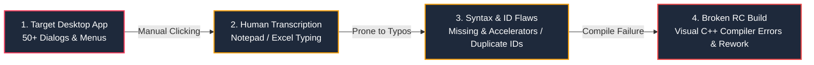
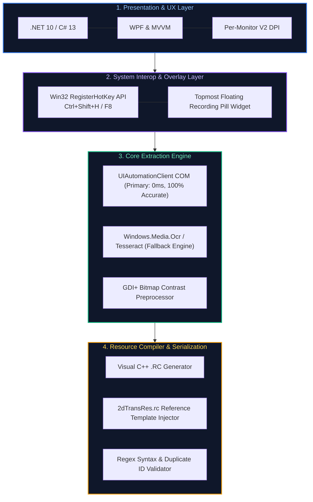
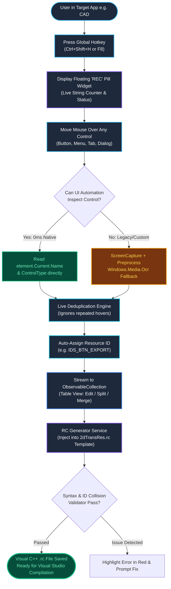

# Proof of Concept: UI-to-RC Resource Generator
## Executive Visual Presentation Deck (5 Slides)

---

### Slide 1: Problem Statement
**Title:** The Problem: Breakdown of Current Manual Workflow  
**Subtitle:** How manual string extraction creates bottlenecks, human transcription errors, and broken C++ builds.

#### 🔄 Manual Workflow Flowchart:


* **⏱️ 16–20 Hours Wasted:** 2 full engineering days spent per release cycle on repetitive manual transcription.
* **⚠️ High Error Rate:** Missing keyboard accelerators (`&File`) and unescaped quotes break resource builds.
* **🛑 OCR Shortcomings:** Vision OCR is slow, inaccurate on small system fonts, and requires manual window cropping.

---

### Slide 2: Proposed Solution
**Title:** The Solution: Automated Live Hover Capture to RC  
**Subtitle:** Replacing manual friction with a zero-latency, automated hover-to-code pipeline.

#### 🔄 Before vs. After Flowchart:

```mermaid
graph TD
    subgraph BEFORE["❌ BEFORE: Manual Multi-Step Friction (16-20 Hours)"]
        B1[Target CAD App] --> B2[Alt-Tab to Notepad]
        B2 --> B3[Manual Typing & ID Guessing]
        B3 --> B4[Manual .RC File Editing]
        B4 --> B5[Compiler Syntax Errors]
    end

    subgraph AFTER["✅ AFTER: UI-to-RC Generator (< 15 Minutes • 100% Accuracy)"]
        A1[Target CAD App] -->|Ctrl+Shift+H| A2[Live Cursor Hover]
        A2 -->|Direct UIA 0ms| A3[Auto-Deduplication & ID Assignment]
        A3 -->|1-Click Validation| A4[Clean 2dTransRes.rc Ready for Build]
    end

    style BEFORE fill:#1c1917,stroke:#ef4444,stroke-width:2px,color:#fda4af
    style AFTER fill:#0f291e,stroke:#10b981,stroke-width:2px,color:#6ee7b7
```


---

### Slide 3: Technology Architecture Chart
**Title:** Technology Architecture: 4-Tier Native System  
**Subtitle:** Layered architecture engineered for native Windows performance, per-monitor DPI, and compiler compliance.

#### 🏗️ Layered System Architecture Chart:


---

### Slide 4: How Our App Works (Main Focus)
**Title:** How Our App Works: End-to-End Pipeline Flowchart  
**Subtitle:** Detailed dataflow from mouse hover to fully validated Visual C++ resource script.

#### ⚙️ Complete Execution Pipeline Flowchart:


* **Step 1: Global Trigger:** Win32 hotkey `Ctrl+Shift+H` starts capture from anywhere; floating widget appears on top.
* **Step 2: Hover Detection:** Direct UI Automation extracts native string & control type with 0 ms latency.
* **Step 3: Auto-Deduplication:** Repeated hovers are ignored; clean identifiers (`IDS_BTN_...`) are auto-generated.
* **Step 4: Template Injection:** Strings are compiled into `STRINGTABLE` blocks adhering to `2dTransRes.rc`.
* **Step 5: 1-Click Validation:** Verifies quotes and ID uniqueness, producing a compile-ready file.

---

### Slide 5: Business Impact & Comparison
**Title:** Business Impact: Measurable ROI & Quality Gains  
**Subtitle:** Quantifiable efficiency gains and complete elimination of resource compiler defects.

#### 📊 Impact Comparison Chart:
```
┌──────────────────────────┬─────────────────────────────┬──────────────────────────────┐
│ Metric                   │ Before (Manual Process)     │ With UI-to-RC Generator      │
├──────────────────────────┼─────────────────────────────┼──────────────────────────────┤
│ ⏱️ Time per 50 Dialogs   │ 16 – 20 Engineering Hours   │ < 15 Minutes (95% reduction) │
│ 🎯 String Accuracy       │ 80 – 85% (Typos, Missed &)  │ 100% (Direct OS Inspection)  │
│ 💥 Compiler Build Breaks │ Frequent RC Syntax Errors   │ 0 Build Breaks (Validated)   │
│ 🔀 Context Switching     │ Constant Alt-Tab & Typing   │ Zero (Floating Topmost Pill) │
└──────────────────────────┴─────────────────────────────┴──────────────────────────────┘
```

> **Recommendation to Manager:** Approve the POC for pilot rollout in our upcoming release cycle.
